# Going through Needs you, one card at a time (design)

Status: design for review (phase 1). The renders come from a working prototype (`client/catch-up.tsx`, `shared/catch-up.ts`)
drawn with Follow-up's own components and synthetic data (`scripts/screenshots.mjs --only catch-up`). Nothing here
ships until the developer picks the open decisions below.

The developer asked for a mode on Follow-up Home where they go through everything that needs them, one item at a time,
mainly on the phone: read the card, act, next card, act, next card. The rhythm matters most. Every card carries what
it takes to decide without opening the chat, and acting never waits on the network.

The working name is **Go through** (one constant, `MODE` in `shared/catch-up.ts`; code identifiers say `catch-up`
until the name is picked). The [name](#the-name) is one of the open decisions.

## The deck

**What goes in.** Exactly what Home's Needs you group holds, expanded to one card per thing to act on:

| Card | From | The card's one primary |
| --- | --- | --- |
| Permission | the agent's pending permission | Allow (Deny beside it) |
| Question | each open question, a multi-decision brief's questions included | Send to agent |
| Ask | an agent's `needs_you` decision, action or review with no tracked question | the brief's own moves (pick, Done, Open PR) |
| Item | every other Needs-you row: Merge, Add reviewers, Send N tasks, an unsent or failed answer (Send, Retry), Resume, Retry, Check state, a blocked task | that row's own button |
| Finished | a flagged finished turn with nothing above | Sign off |

A workspace with two questions and a merge is three cards. Snoozed items (Later) aren't in the deck.

**Order.** Home's Needs-you order, so the deck never disagrees with the list the developer already sees: blocking asks
first (permissions, errors, questions that stopped an agent, decisions), then actions (merge, reviewers, sends), then
finished turns to sign off; inside a tier, the developer's chosen sort, AI priority included. Inside one workspace the
Needs-you block's order (`needsYouBlock`): permission, stopped questions, other questions, then the rows. A workspace's
cards stay together, so its context is read once and the card says "2 of 3 here".

Alternatives considered: quick wins first (merges and sign-offs before questions) gets the count down fast but leaves a
stopped agent waiting longest; AI priority across tiers ignores that a stopped agent is idle until answered. Recommended:
Home's order.

**One source, no reads of its own.** The deck is a pure function (`deckCards`) of Home's model, the inbox rows and the
listed workspaces the client already holds through the feeds. Opening it costs nothing; it adds no polling.

### Every card in the demo deck, in order

The synthetic deck (17 cards from 12 workspaces), on a phone, in the order Go through shows them:

| | | | |
| --- | --- | --- | --- |
| 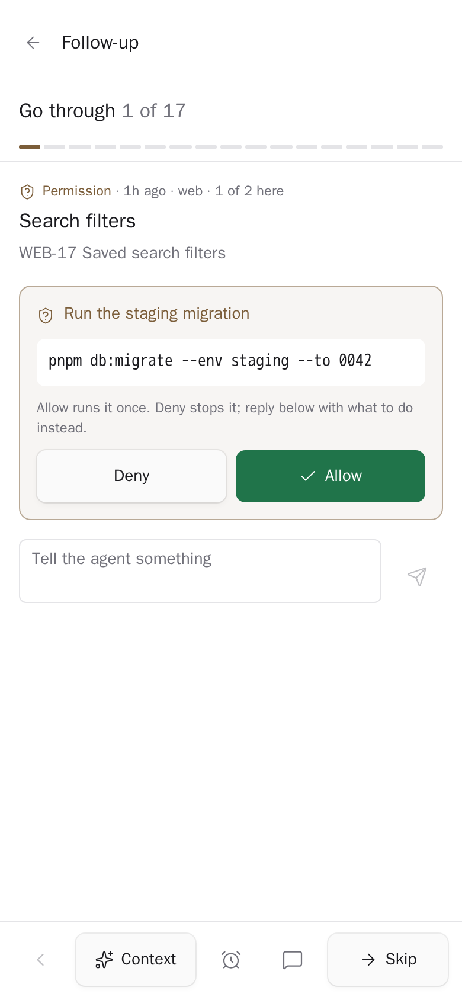 | 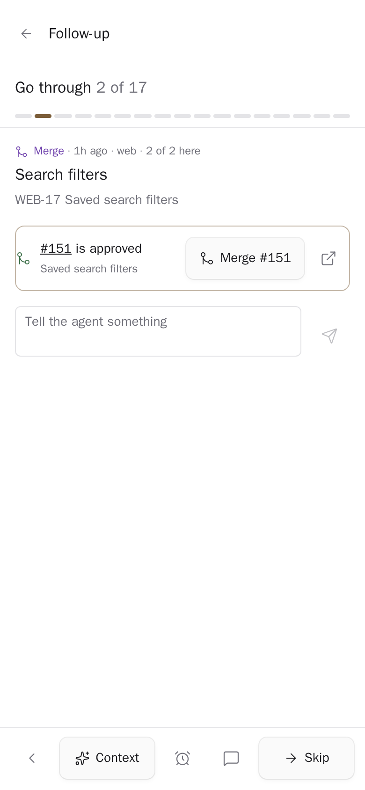 | 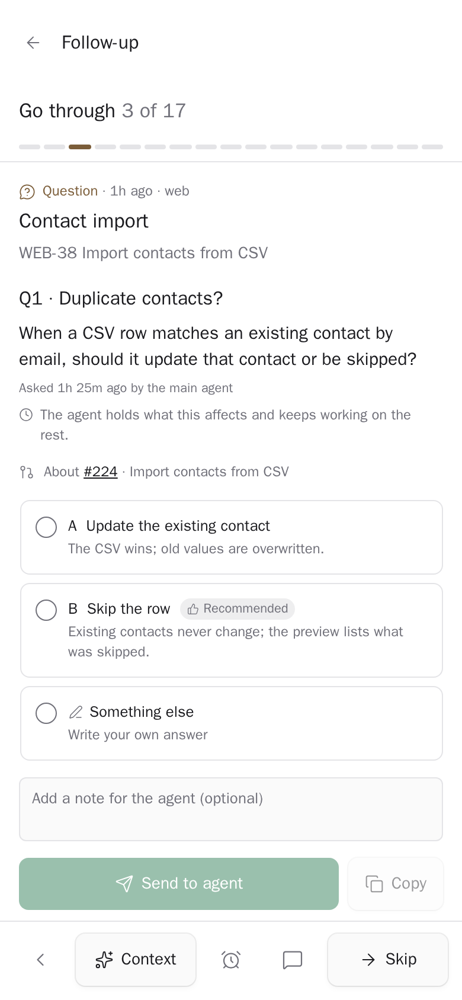 |  |
| 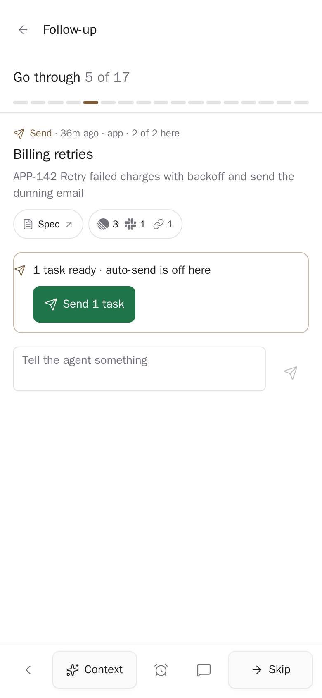 | 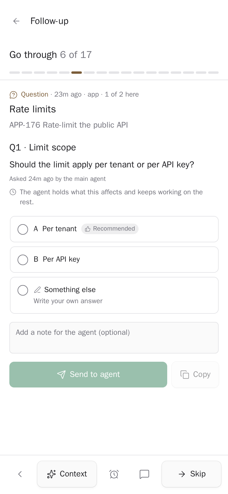 | 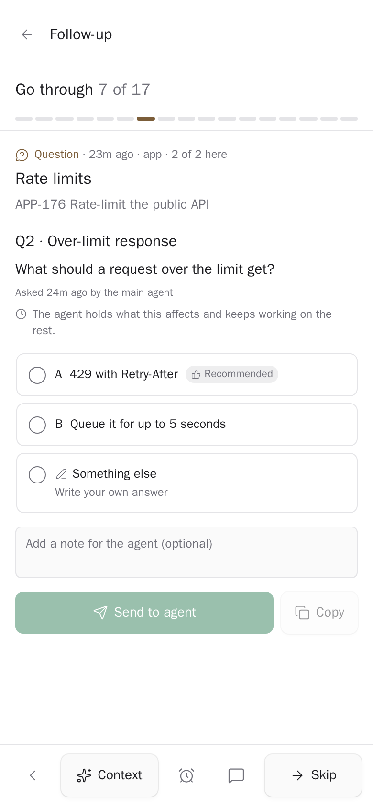 | 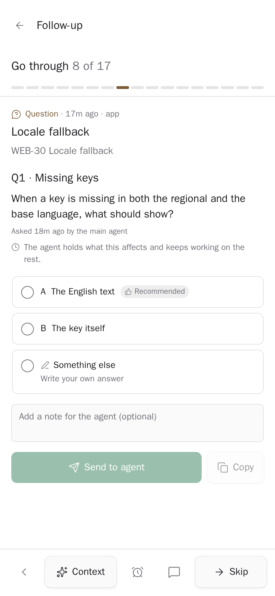 |
| 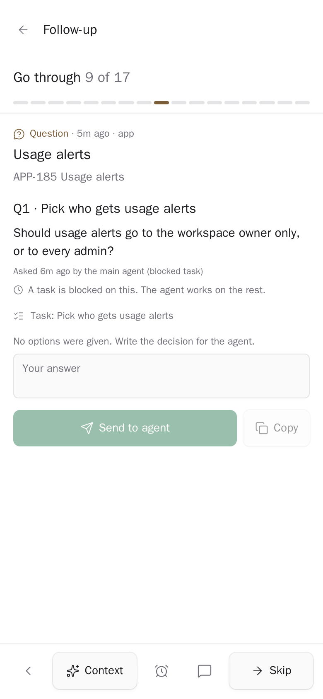 | 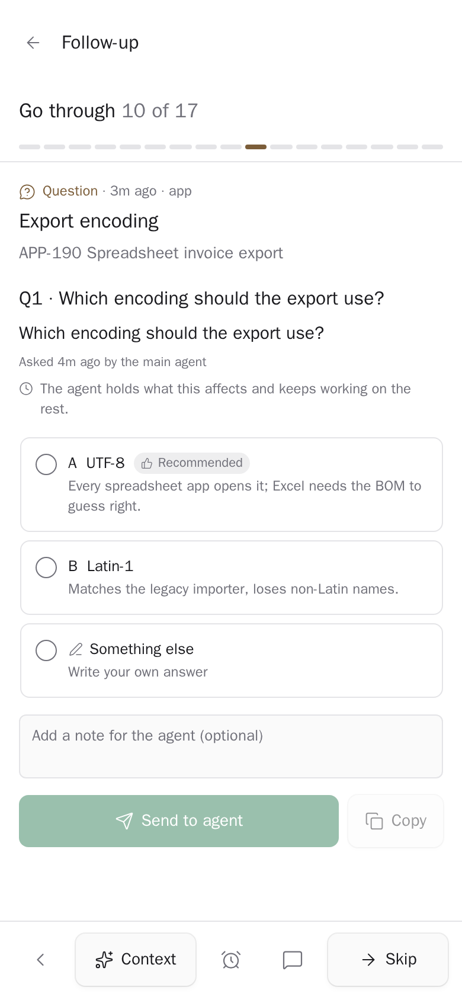 | 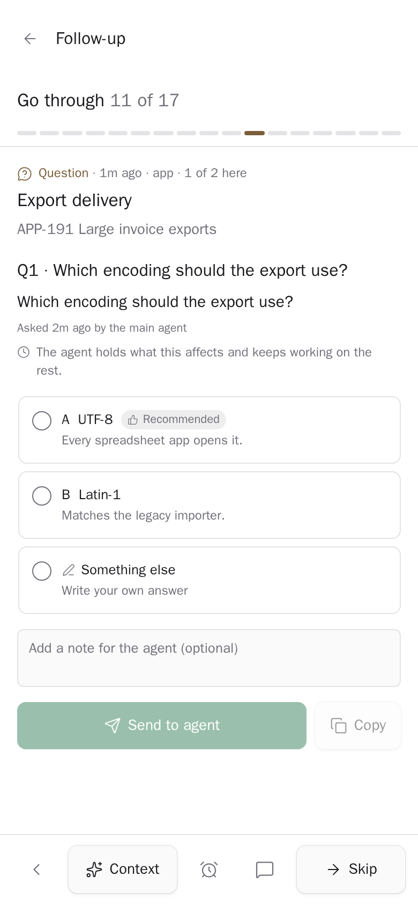 | 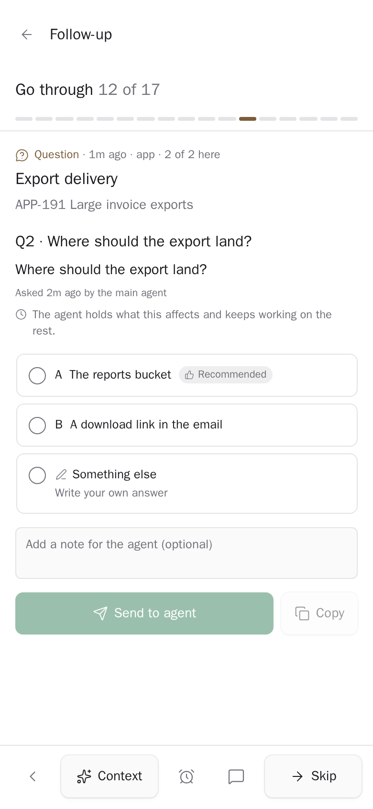 |
| 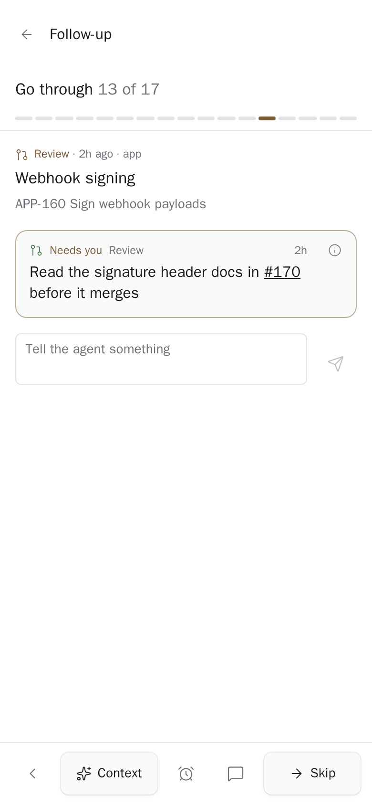 | 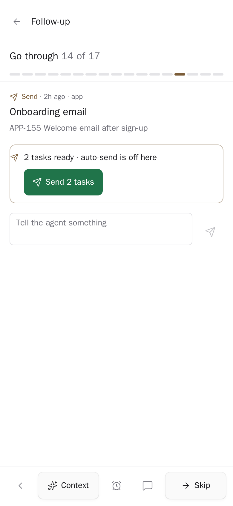 | 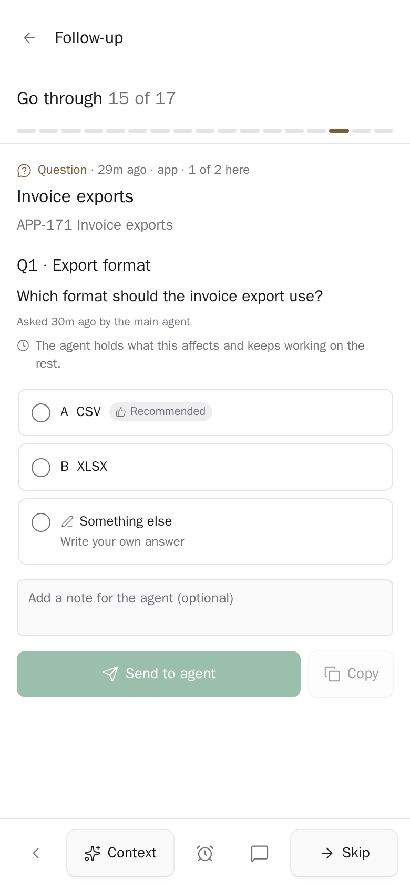 | 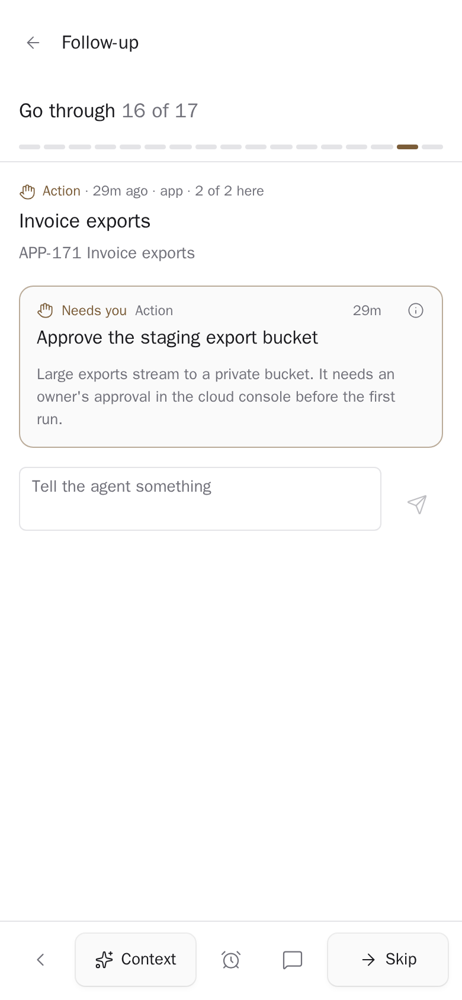 |

## The card

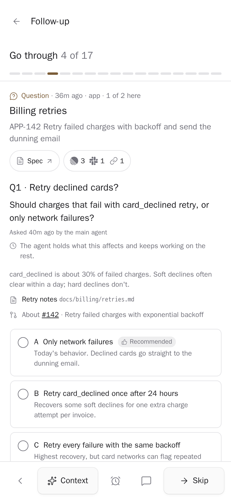

Top to bottom:

1. **Progress.** "Go through 3 of 17" and a segmented bar, one segment per card: done in the foreground colour, skipped
   faded, the current one amber (what needs you), the rest the track; past 24 cards it becomes one continuous bar.
   Desktop has Leave (×) on the left; on a phone the host header's ← is the only back control (DESIGN.md, One header).
2. **Who.** The state word in its colour (Question, Merge, Permission), age, project, and "2 of 3 here" when the
   workspace has more cards. Then the workspace title (› agent when it has several roots), its Summary line, and the
   references line (spec, linked issue, Slack thread): the same lines Home's detail pane shows.
3. **The ask, through the surface's own component.** A question is `QuestionBody`, the same body as the question
   dialog, the pill and the panel: the question, what the agent does meanwhile, the background, links and the PR it is
   about, the lettered options with Recommended, Something else, the note field, Send to agent and Put in chat. A
   Needs-you row is `NeedsYouList` with that one row (Merge names its scope, one click). An ask is the brief card. So
   the answer flow is the shared one, never a fork: when the shared answer flow lands (panel-own-answer), the card gets
   it for free.
4. **Tell the agent something.** A card that isn't a question has a one-line reply field (a question has its note).
5. **The deck's moves**, secondary, pinned in thumb reach on phones: Back, Context (more context), Later, Open chat,
   Skip.

Deep context folds, so a card fits a phone: the background is a few lines, the references line is one row of chips,
Recent steps aren't on the card (they would load an unloaded agent; Open chat is one tap).

### Layout: two directions on phones

| A. One card (recommended) | B. Answer sheet |
| --- | --- |
|  | 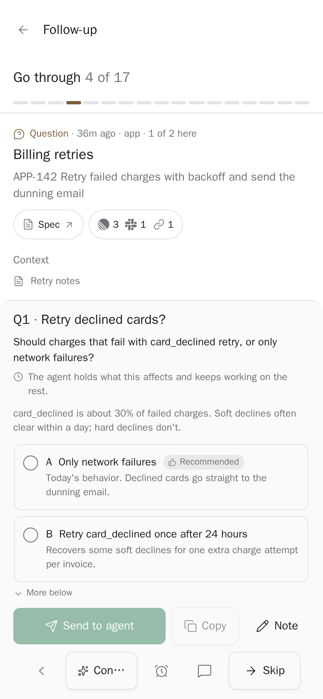 |

- **A. One card.** Everything scrolls as one card; the deck's moves sit in a bar at the bottom. Reads top to bottom
  like the question dialog the developer already knows. Long options push Send down a scroll.
- **B. Answer sheet.** Context scrolls above; the question, options and Send sit in a sheet pinned to the bottom, in
  thumb reach. Faster on long cards, but the sheet takes half the screen, so the context window is small, and on a
  short card the screen is half empty.

Recommended: A. Most cards are short; one scroll for a long one is cheaper than half a screen for the sheet.

### Desktop: queue rail or one column

| Queue rail (recommended) | One column |
| --- | --- |
| 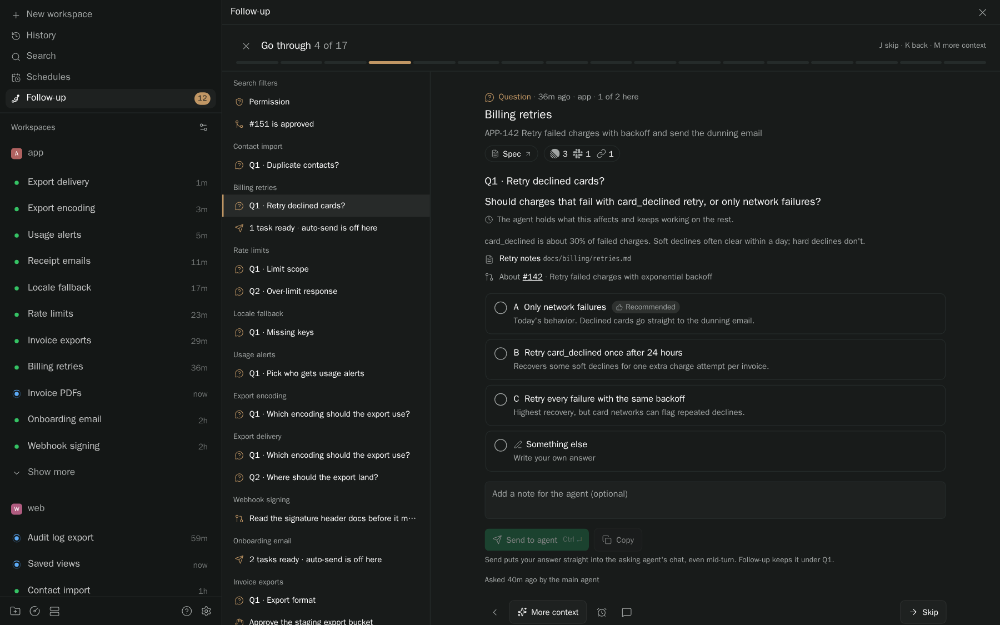 | 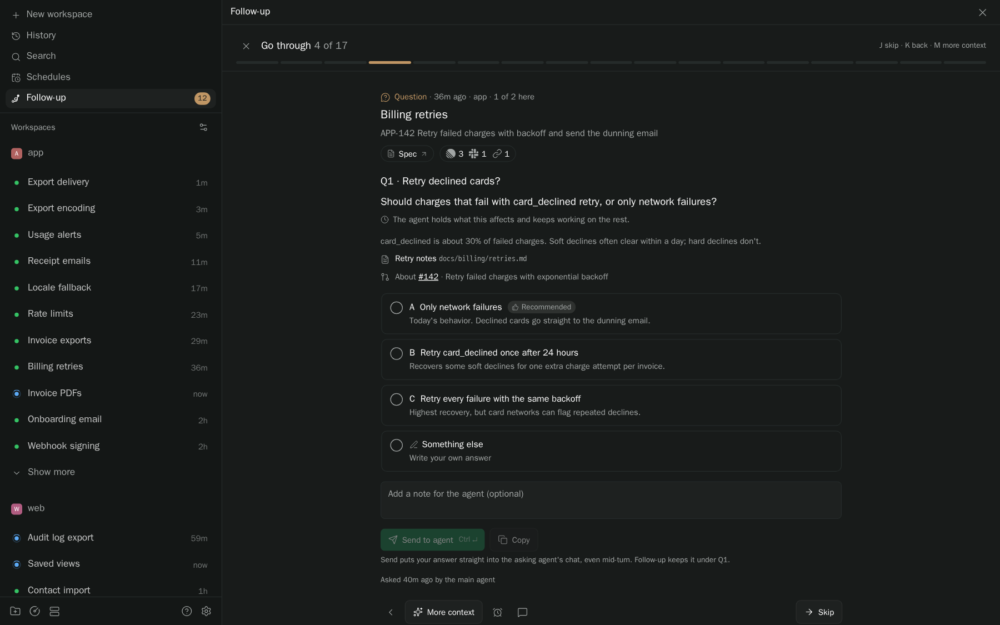 |

The rail lists every card under its workspace, the current one marked amber, done ones checked and struck through,
skipped ones with a corner arrow; a click jumps. It is the progress, the map and Back in one, and desktop has the room. In phase 2 the rail sits in a `ResizableSplit` like Home's pane (`side-panes-are-resizable`); the prototype draws it at a fixed 300 px.

## Actions

Every action is one tap, and the card leaves the moment it is taken. The work runs in the background.

| Action | What it does |
| --- | --- |
| **Answer** | Pick an option and Send (or write your own through Something else). Goes through `follow.answer-question` and the durable message queue; the card moves on at once, a failure comes back as "Not sent · Retry" on the card and in the finished summary. |
| **Add context** | The note field under the options: words for the agent with the answer ("The developer added: …"). Without answering: the same field with Send note, a plain message to the agent; the card stays. |
| **More context** | See below. |
| **Skip** | Moves on; the card waits at the end ("Go through 2 skipped"). Nothing changes on the server. |
| **Later** | The row's Later (snooze), the same four choices as Home; the card leaves the deck. |
| **The item's own button** | Merge, Add reviewers, Send N tasks, Allow, Sign off, Retry: the Needs-you row's own button, the same path. |
| **Open chat** | The agent's chat (desktop docks the panel beside it), the deck keeps its place. |

Agent parity: each of these already has its agent tool (`answer_question`, `brief_action`, `inbox_act`, `send_repairs`,
`pr_action`, …). New in phase 2: `catch_up_deck` (read: the deck in order, what each card holds) and the "ask the agent
to explain" action as a planned/confirmed tool.

### More context

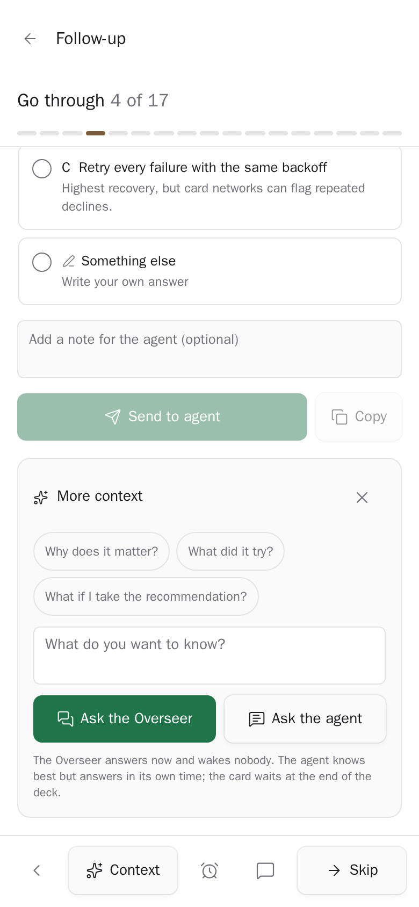

Three ways to get more, and the recommendation is to offer two of them together:

- **Ask the Overseer, inline (recommended default).** The answer appears on the card in seconds. The Overseer already
  reads every workspace's state and the agents' transcripts on disk, so it never wakes the asking agent. Suggested
  questions are one tap ("Why does it matter?", "What did it try?", "What if I take the recommendation?").
- **Ask the agent to explain (recommended second).** Authoritative but slow: the question goes to the asking agent as a
  message, the card leaves the deck ("1 explaining" in the progress line) and comes back at the end when the agent
  answers (its next brief or its updated question). This wakes the agent, but only because the developer asked.
- **Overseer only** is instant but can be wrong about the agent's intent; **agent only** stalls the rhythm on every
  question.

| Overseer answer on the card | Asked the agent: the card waits |
| --- | --- |
| 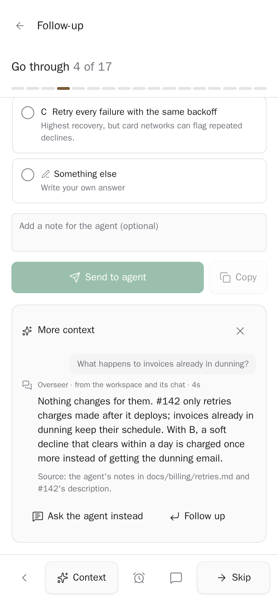 | 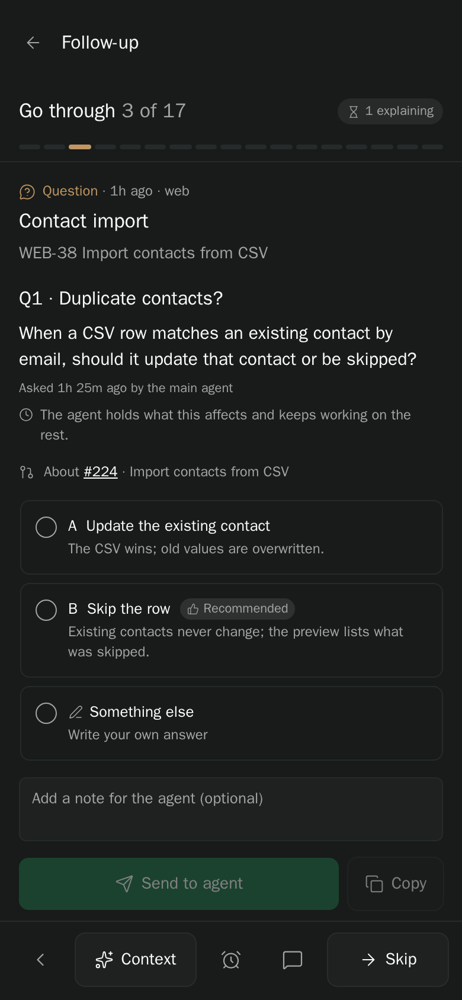 |

With the Overseer off, More context offers only Ask the agent.

## Flow

- **Entry.** "Go through 17" is the primary on Home: the morning brief's button on desktop (it replaces "Open <first>"),
  a full-width button under the status strip on phones. Also ⌘K "Follow-up: Go through what needs you", the sidebar
  view's Needs-you header, and the pill when more than one workspace needs you. The count is cards, the deck the mode opens on.
- **Progress.** "3 of 17" and the bar; on desktop the rail too.
- **Back.** The Back move, K or ←, a swipe right. A card already answered shows its recorded answer and delivery
  state (the question body already does), so going back never answers twice.
- **New item mid-session.** Appended at the end, never under the developer's thumb: "1 new · at the end" in the
  progress line, the count grows.
- **Resolved elsewhere** (answered on the desktop, the agent withdrew it, the PR merged): a card still ahead drops out
  silently; the card on screen says "Handled elsewhere. Nothing left to do here." with Next.
- **Finished.** "Nothing else needs you", with what happened ("7 done · 2 skipped · 1 for later · 1 waiting on an
  explanation"), what happens next (answers are on their way, new asks show in Needs you and the pill), Go through N
  skipped, and Back to Home.

| New item arrived | Handled elsewhere | Finished |
| --- | --- | --- |
| 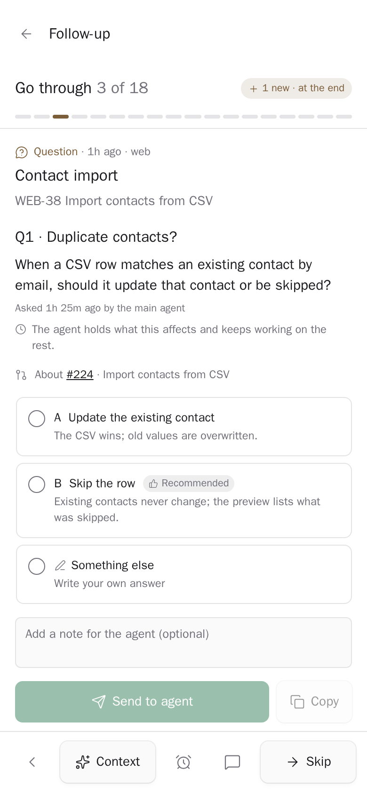 | 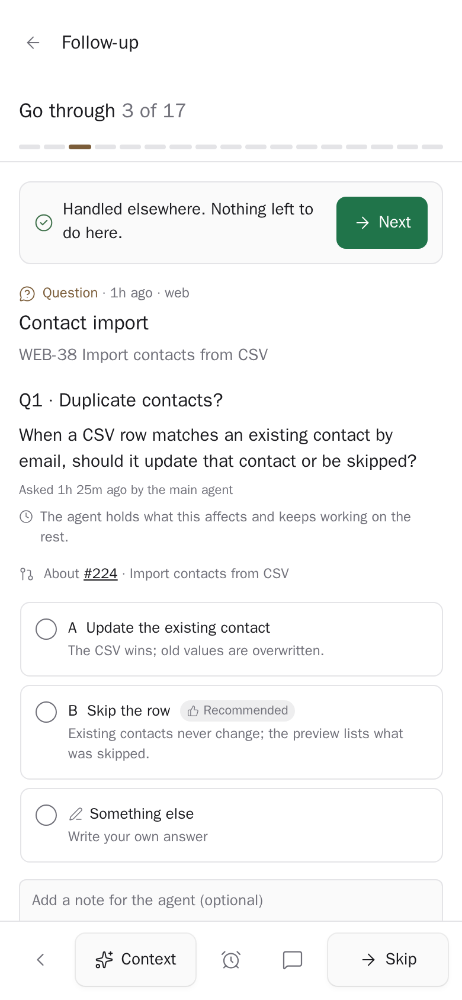 | 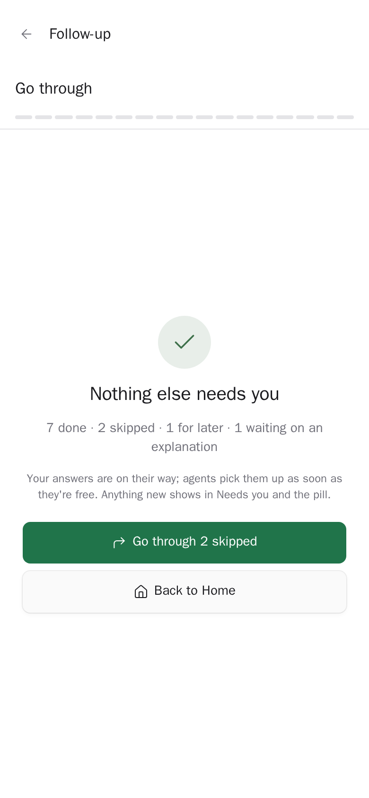 |

## Gestures and keys

**Phone.** Swipe left to skip, right to go back. Answering is never a swipe: a stray thumb must not decide anything.
Every target is 44 or more; the moves sit at the bottom, in thumb reach. When the keyboard opens for a note, the card
scrolls the field above it and the moves hide (the detail pane already does this with `typing`).

**Desktop** (`CATCH_UP_KEYS`, only while the mode is on screen and never while typing):

| Key | Does |
| --- | --- |
| A–H | pick that option |
| W | write your own answer (Something else) |
| ⌘↵ (Ctrl↵) | send (the existing `SubmitScope` rule) |
| J or → | skip |
| K or ← | back |
| M | more context |
| N | add a note |
| L | later |
| O | open chat |
| Esc | leave |

No collisions: option letters stop at H and the moves use J to W. Home's own keys (j/k, Enter, /) aren't mounted while
the mode is on screen, ⌘/ stays Search from anywhere, and nothing takes a modified key Paseo binds (`PASEO_BOUND`).

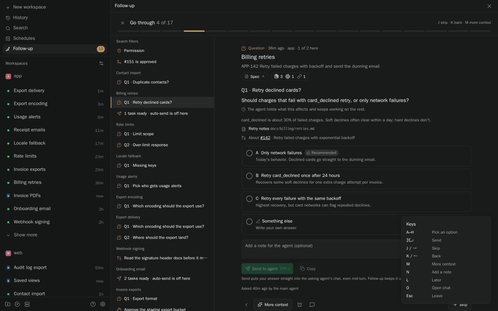

## Speed

- The next card shows instantly: the deck is already on the client, and the next card's full workspace read
  (`follow.get`, for the PR sheet and references) is fetched while the current card is on screen. One read per card,
  only for the next one.
- Sending never blocks: answers go through the durable message queue (`a-message-is-saved-before-sent-and-arrives-once`);
  the card moves on as soon as the action is handed off, as quick actions already do (`runAction`, pending answers).
- No new polling: the deck re-derives from the feeds Home already subscribes to.
- No agent wakes, except when the developer asks an agent to explain.

## The name

| Name | Why | Home button | ⌘K | Progress | Finished |
| --- | --- | --- | --- | --- | --- |
| **Go through** (recommended) | Plain, a verb, says what you do and works any time, not only after time away. | Go through 17 | Follow-up: Go through what needs you | Go through 3 of 17 | Nothing else needs you |
| One by one | Names the mechanic exactly; reads less like an action on a button. | One by one · 17 | Follow-up: One by one | One by one 3 of 17 | Nothing else needs you |
| Triage | Familiar to developers, short. But it means sorting, and here you decide and act. | Triage 17 | Follow-up: Triage what needs you | Triage 3 of 17 | Triaged everything |
| Focus | Short, calm. Clashes with the OS's Focus modes and with keyboard focus in docs and code. | Focus · 17 | Follow-up: Focus on what needs you | Focus 3 of 17 | Nothing else needs you |

## Decisions for the developer

1. **Name:** Go through (recommended), One by one, Triage, or Focus.
2. **Phone layout:** A one card (recommended) or B answer sheet.
3. **Desktop:** queue rail (recommended) or one column.
4. **More context:** Overseer inline plus Ask the agent (recommended), Overseer only, or agent only.
5. **Answering speed:** pick then Send, two taps (recommended: the note field sits between them, and Back shows what
   was sent), or one tap on an option sends at once with a 6-second Undo (faster, but no room for a note).
6. **Deck order:** Home's Needs-you order (recommended) or quick wins first.

## Phase 2 plan (after the picks)

Small stacked PRs, each green on its own:

1. Server and tools: `catch_up_deck` (read) and "ask the agent to explain" (planned/confirm, audited; the card's return
   is the agent's next brief or question update), parity entries, tests for the deck order and its edge cases.
2. The mode: the card, the deck, entry points, finished state, live updates (new at the end, handled elsewhere),
   offline and queued answers; release-note fragment.
3. Gestures, keys and polish; invariant `the-deck-is-needs-you-in-home-s-order`.
